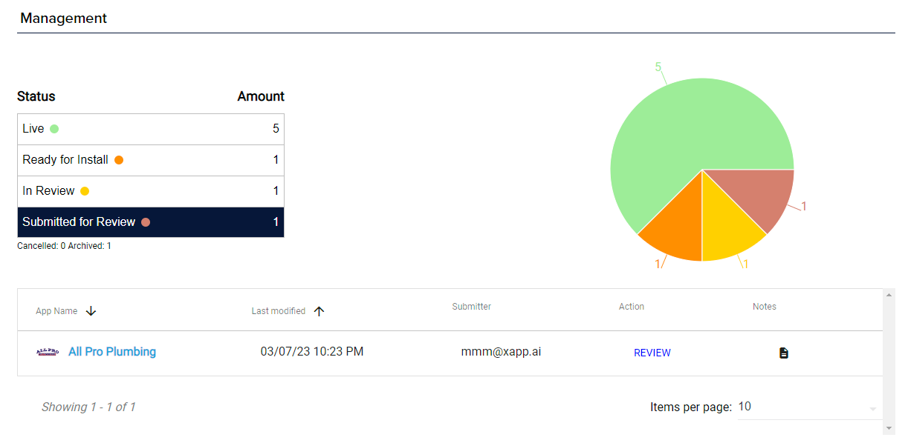

## What are partner tools?

We provide a special set of tooling and features in Studio to help meet the needs of our partners.  They help support the level of scale needed to manage thousands of assistant applications.

### Fleet Management

Fleet management provides a high level view of all the applications within your organization.  This is helpful to see where they are in the review process (if applicable) or if they are live or not.

### Quality Assurance

We perform all of the quality assurance checks for you.  Through the use of automation and actual manual checks, we will test and fix any errors within the virtual assistant pre and post launch.

### Customization through Studio

You will have access to all the features of Studio, which provides you the ability to make many customizations through our graphical user interface.  If your customer has a request, you can delight them by quickly making the change for them in seconds.

You can quickly:

* Change color or style of the chat widget
* Update greetings or suggestion chips
* Update logos and assistant names

__Read More__

* [Widget Customization](/docs/channels/channel-chat-widget#configuring-the-widget-within-studio)
* [Opportunity Alerts](/docs/studio/opportunity-alerts)
* [White Label Branding](/docs/partners/white-label-branding)
* [Partner Integration](/docs/partners/partner-integration)

### Developer Tools

The **Developer Tools** page in your partner organization has everything for building against the [partner API](/docs/partners/partner-integration):
* the API's base URL and GraphQL endpoint
* links to the [API reference](https://api.xapp.ai/partner/docs) and the [OpenAPI spec](https://api.xapp.ai/partner/openapi.json)
* your organization's [partner API keys](/docs/partners/partner-api-keys)

Only Organization Owners and Admins can open it.

### Status Updates

Read each business's status with the partner API: one business with `GET /partner/v1/businesses/{businessId}`, or all of them with `GET /partner/v1/businesses?status=`. A business moves from `provisioning` through `in_review` to `live`. See [Setting up a business](/docs/partners/partner-integration#2-follow-its-status).
