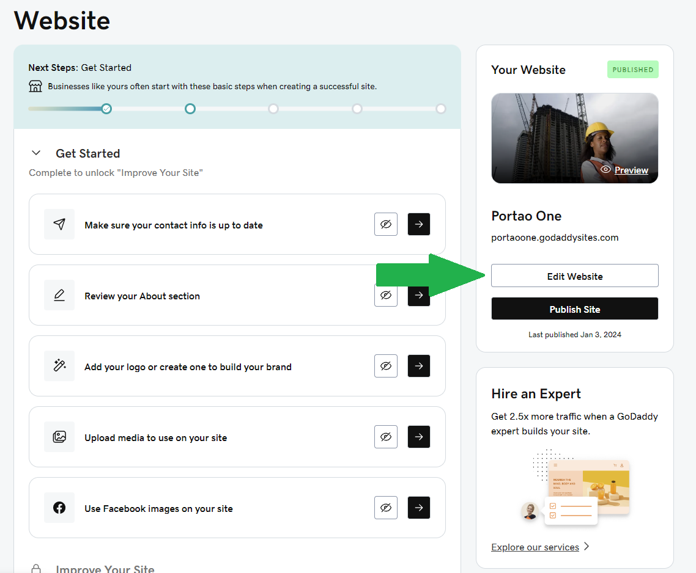
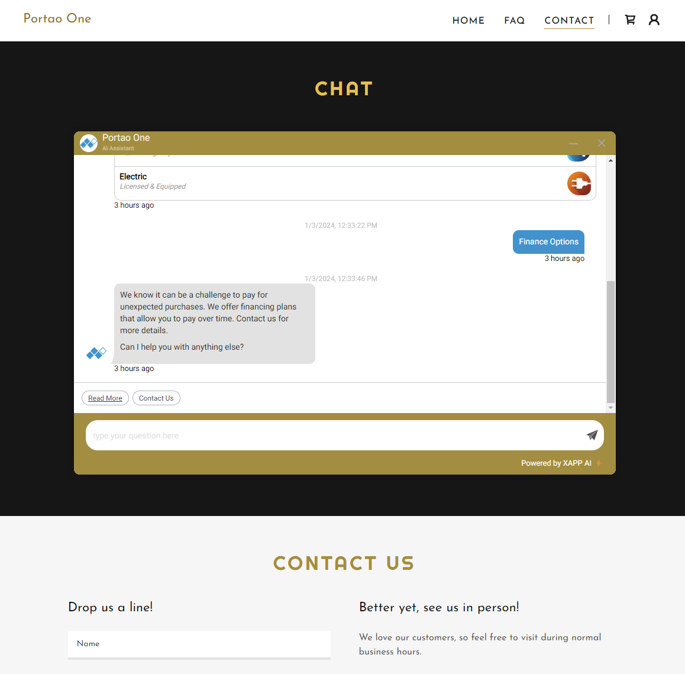

# Add the website widget to GoDaddy Website Builder

GoDaddy Website Builder keeps custom code inside the section you add it to. That means the widget will not float in the corner of every page the way it does on other platforms; it shows inside one section of one page. Because of this, we recommend adding it to your Contact Us page.

## Before you start

- You need administrator access to your GoDaddy site.

## Steps

1. Sign in to GoDaddy and go to your Website Builder dashboard.

2. Select `Edit Website` (or `Edit Site`) and open your Contact Us page.

   

3. Click the `+` button just below the site header to add a section, and choose the `HTML` section.

   

4. Set the section Title to "Chat".

5. Paste the code below into the Custom Code field:

   ```html
   {{snippet}}
   ```

6. Set `Forced Height` to `600` and turn on `Center align`.

7. Adjust the section settings as needed, preview your page, then click `Publish`.

   

The widget works best on GoDaddy when it is set to open automatically and sized larger (about 1500 px wide by 800 px tall). Whoever provided your code can switch that on for you.

## Check it worked

Visit your live Contact Us page. The widget should appear inside the new Chat section. It can take a few minutes to show up; if you don't see it, clear your browser cache or open the page in a private window.

## Troubleshooting

- **Widget not appearing**: make sure you published the site after adding the HTML section.
- **Widget looks cut off**: increase the section's `Forced Height`.
- **Widget only on one page**: this is expected on GoDaddy Website Builder; the code only runs inside the section it is in.
