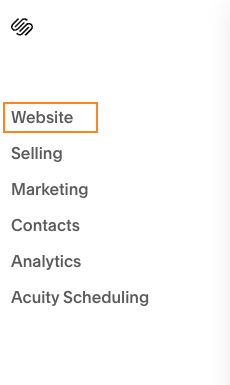
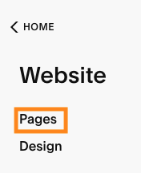
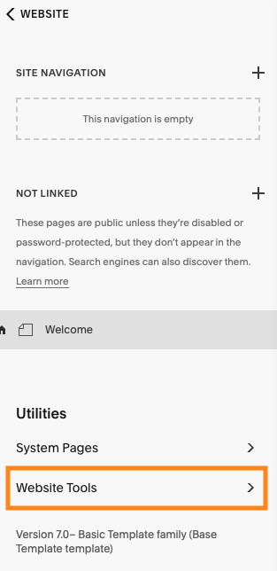
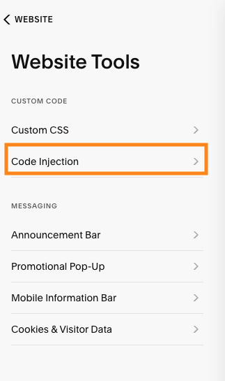
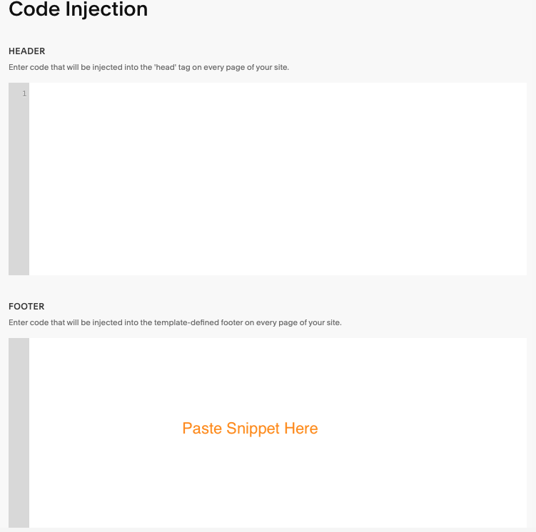

# Add the website widget to Squarespace

## Before you start

- You need administrator access to your Squarespace site.
- Your site must be on the Business plan or higher. Lower plans do not allow custom code.

## Steps

1. Log in to Squarespace and open your site's dashboard.

2. Go to `Website`, then `Pages`.

   

   

3. Scroll down to `Utilities` and choose `Website Tools`.

   

4. In the Custom code section, choose `Code Injection`.

   

5. Paste the code below into the `Footer` box:

   

   ```html
   {{snippet}}
   ```

6. Click `Save`.

## Check it worked

Visit your live website. The widget button should appear on the page. It can take a few minutes to show up; if you don't see it, clear your browser cache or open the site in a private window.

## Troubleshooting

- **Widget not appearing**: make sure the code is in the `Footer` box (not the Header) and that you clicked `Save`.
- **No Code Injection option**: code injection needs the Business plan or higher.
- **Still nothing**: open your browser's developer console and look for script errors on the page.
