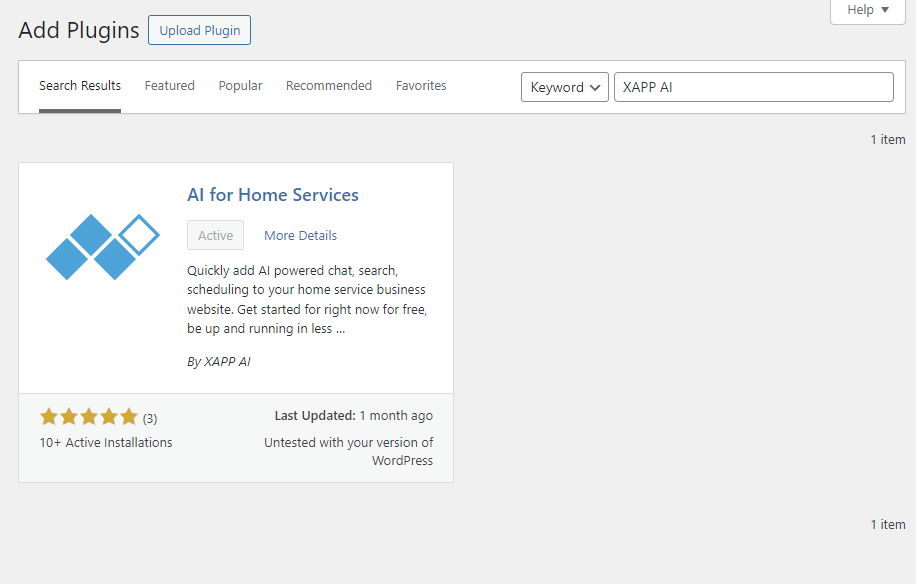
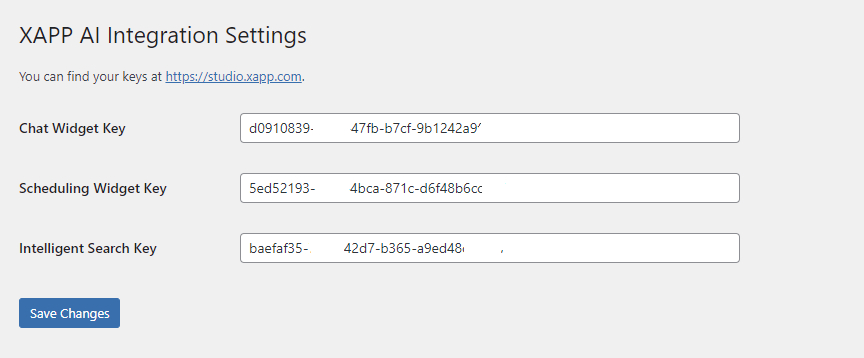
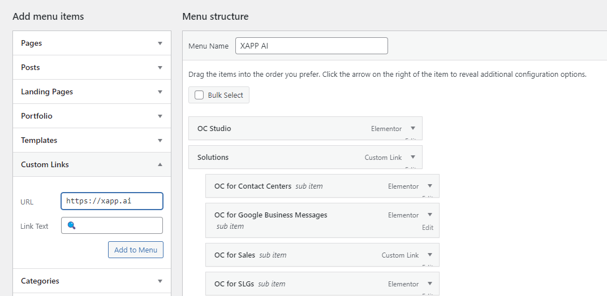
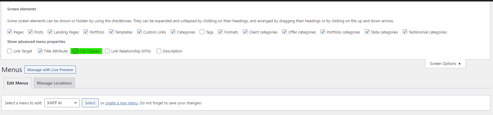
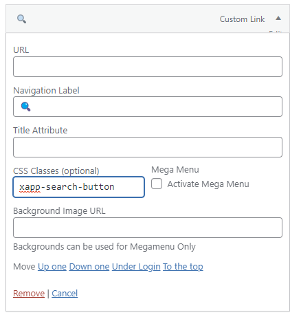

import AgentGuide from "./_agent-partials/wordpress.md";

If you have a website hosted on WordPress, you can be up and running in minutes leveraging our WordPress plugin.

## Prerequisites

Before proceeding, ensure that you have:

- Administrative access to your WordPress website.
- WordPress version 4.6 or higher installed.

## Installation

### Method 1: Installing via WordPress Admin Panel

1. **Access WordPress Admin**: Log in to your WordPress admin dashboard.

2. **Navigate to Plugins**: On the admin sidebar, click on `Plugins > Add New`.

3. **Search for "XAPP AI"**: In the search field, type `XAPP AI` and press Enter.

<div className="centered-image-container">
  
</div>

4. **Install the Plugin**: Locate `AI for Home Services` in the search results and click on `Install Now`.

5. **Activate the Plugin**: After installation, click on `Activate` to enable the plugin on your WordPress site.

6. **Configure the Plugin**: Navigate to AI for Home Services settings from the WordPress admin side by: "Tools" --> "XAPP AI Settings"

7. **Paste in your Keys**: For each key, you will need to copy paste your keys from each channel.

   <KeyDisplay />

   - [How to Find the Chat Widget Key](/help/channels/chat-widget#finding-code-snippet--key)
   - [How to Find the Intelligent Search Key](/help/channels/intelligent-search#finding-code-snippet--key)
   - [How to Find the Form/Scheduling Widget Key](/help/channels/form-widget#finding-code-snippet--key)

8. **Save Changes**: After saving your changes, your configured widgets should appear.

   <div className="centered-image-container">
     
   </div>

### Method 2: Manual Installation via FTP

1. **Download the Plugin**: Visit [AI for Home Services Plugin Page](https://wordpress.org/plugins/oc-studio-integration/) and download the latest version of the plugin.

2. **Unzip the Plugin**: Extract the downloaded `.zip` file to a folder on your computer.

3. **Upload via FTP**: Using an FTP client, upload the extracted plugin folder to the `/wp-content/plugins/` directory on your WordPress server.

4. **Activate the Plugin**: Log in to your WordPress admin dashboard, navigate to `Plugins`, and find `OC Studio Integration` in the list. Click `Activate`.

## Configure the WordPress Plugin

We will need to configure the plugin with the special keys for your chat and search (optional) widgets.

Within the WordPress Admin panel, navigate to the new OC Studio Settings page found under the Tools settings. The same settings page can be found under Settings -> XAPP AI.

Find the keys within studio, and paste them into your plugin configuration page.

- [How to Find the Chat Widget Key](/help/channels/chat-widget#finding-code-snippet--key)
- [How to Find the Intelligent Search Key](/help/channels/intelligent-search#finding-code-snippet--key)
- [How to Find the Form/Scheduling Widget Key](/help/channels/form-widget#finding-code-snippet--key)

A completed plugin configuration will look like the follow:

<div className="centered-image-container">
  
</div>

The chat widget will not appear, by default, in the lower right hand corner of every page on your website.

## Setting Up a Search Button

In order for the search widget to be trigger, you will need to setup at least one button with the `xapp-search-button` class setting.

### Menu Item

The most straight forward way to add a search bar button is by a menu item.

1.  In your WordPress Admin panel, go to Appearance, then Menus.
2.  Select the menu you want to edit
3.  Under "Add menu items, expand "Custom Links"

    <div className="centered-image-container">
      
    </div>

4.  The URL does not matter as it will not be followed but is required, for the Link Text you can put "Search" or "🔍".
5.  Click "Add to Menu" and you will see it at the bottom of the menu you are editing.
6.  Scroll to the top of the page and click "Screen Options", then within that menu select "CSS Classes"

    <div className="centered-image-container">
      
    </div>

7.  Scroll back down to your newly added menu item and expand menu to edit. In the field "CSS Classes (optional)" add "xapp-search-button". This is how the search code will find the button. Note: You can also remove the URL at this point if you want. It was only required to add the menu item.

    <div className="centered-image-container">
      
    </div>

8.  Save and then verify by clicking on the new menu button on your home page. A search widget will appear when you click.

## Different Widgets on Different Pages (Multiple Locations)

If your business has several locations on one website, the plugin (version 1.3 and later) can load each location's chat and scheduling widgets on that location's pages. Leads from those pages then go to the right location, and the rest of your site keeps using your default widgets.

You set this up in the **Per-page widgets (advanced)** section of the plugin's settings page. The keys at the top of that page stay your site-wide defaults.

### How Pages Are Matched

Each rule has a **Path**, a **Chat Widget Key**, a **Scheduling Widget Key**, and an optional **Label** so you can tell the rules apart.

- A rule covers its path and every page under it. A rule for `/locations/texas/dallas/` covers `/locations/texas/dallas/pest-control/` too.
- Paths match whole segments only. `/locations/texas/dallas/` does not cover `/locations/texas/dallas-fort-worth/`.
- When more than one rule fits a page, the longest path wins. This means a rule for a single city page can sit inside a broader rule for its state.
- Capital letters, query strings such as `?utm_source=google`, and a missing trailing slash are all ignored. You can also paste a full URL, and the plugin keeps only its path.
- Pages that no rule covers load the default keys.
- If you leave a key blank in a rule, that widget doesn't load on the rule's pages. For example, a blank Scheduling Widget Key shows only the chat on those pages.

### Adding Rules

1. In the WordPress Admin panel, go to Settings -> XAPP AI and scroll to **Per-page widgets (advanced)**.
2. Click **Add rule** and fill in the Path, the location's keys, and a Label.
   - [How to Find the Chat Widget Key](/help/channels/chat-widget#finding-code-snippet--key)
   - [How to Find the Form/Scheduling Widget Key](/help/channels/form-widget#finding-code-snippet--key)
3. Repeat for each location, then click **Save Changes**.

To delete a rule, click **Remove** on its row, then click **Save Changes**.

### Quick Import

If you have many locations, you can paste all of them at once instead of adding rules one by one. Put one rule per line in the **Quick import** box, in this order: path, chat widget key, scheduling widget key, label.

```text
# path, chat widget key, scheduling widget key, label
/locations/texas/dallas/, CHAT_KEY_DALLAS, FORM_KEY_DALLAS, Dallas
/locations/texas/houston/, CHAT_KEY_HOUSTON, FORM_KEY_HOUSTON, Houston
/locations/oklahoma/tulsa/, CHAT_KEY_TULSA, , Tulsa (chat only)
```

- You can separate the fields with commas or with tabs. Tabs mean you can copy the rows straight out of a spreadsheet.
- Blank lines and lines starting with `#` are ignored.
- If two lines have the same path, only the first one is used.

Click **Preview** to check the lines, then choose one of these:

- **Replace all rules** swaps your current rules for the imported ones.
- **Merge (same path overwrites)** adds the imported rules to the ones you already have. An imported line replaces any existing rule with the same path.

Click **Save Changes** to keep the imported rules.

### Remembering the Visitor's Location

Turn on **Remember the visitor's location for their visit** if your location pages link to shared pages such as `/contact/` or `/get-a-quote/`. With it on, a visitor who opened a location's page keeps that location's widgets on pages that no rule covers. This lasts until they close the browser tab.

Pages that a rule covers always use that rule. The setting is stored in the visitor's browser, so it keeps working with page caching plugins.

### Testing a Page

To check which widgets will load on a page, enter its URL in **Test a URL** and click **Which widgets load here?** The test uses the rules on the settings page as they are now, including changes you haven't saved. Once you save, open a few location pages in a private window to confirm the right widgets appear. If you use a caching plugin, clear its cache first.

<AgentGuide />

### What the plugin adds for AI assistants

The plugin (version 1.2 and later) also publishes your business's assistant at the addresses AI assistants check on your site, such as `/.well-known/mcp/server-card.json`. There's no setup beyond your Chat Widget Key, and you can turn it off under the plugin's settings. See [AI Agent Discovery](/docs/ai-agents/ai-agent-discovery).

## Troubleshooting

If you encounter issues during installation, check the following:

- Ensure WordPress is up-to-date.
- Confirm that you have administrative privileges.
- Check for plugin compatibility with your WordPress version.
- For manual installations, verify that the plugin files were uploaded correctly.

For additional WordPress support, visit the plugin's [OC Studio Integration Support Forum](https://wordpress.org/support/plugin/oc-studio-integration/).
